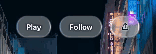
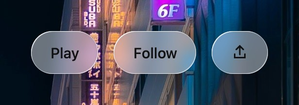
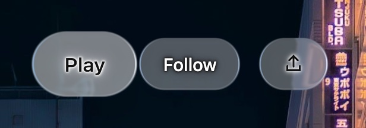
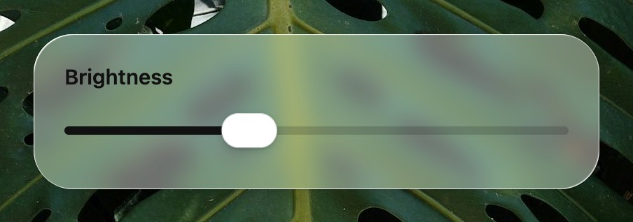
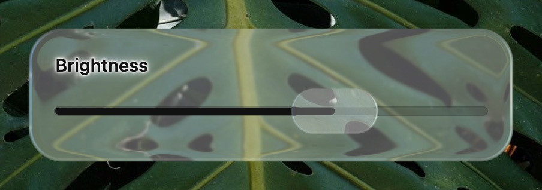
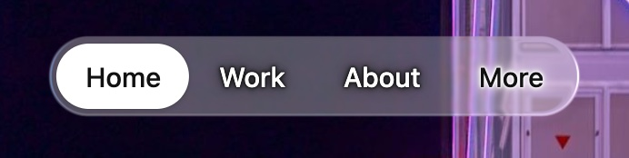
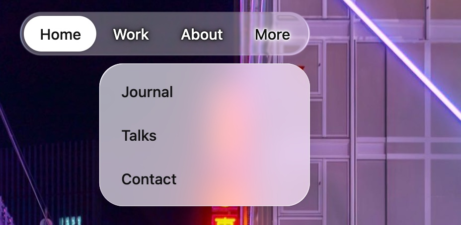
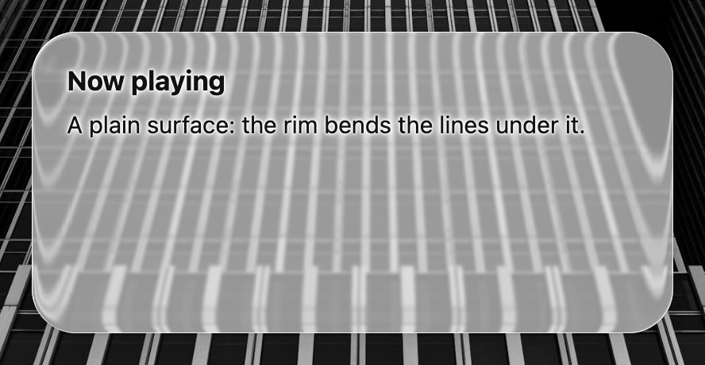
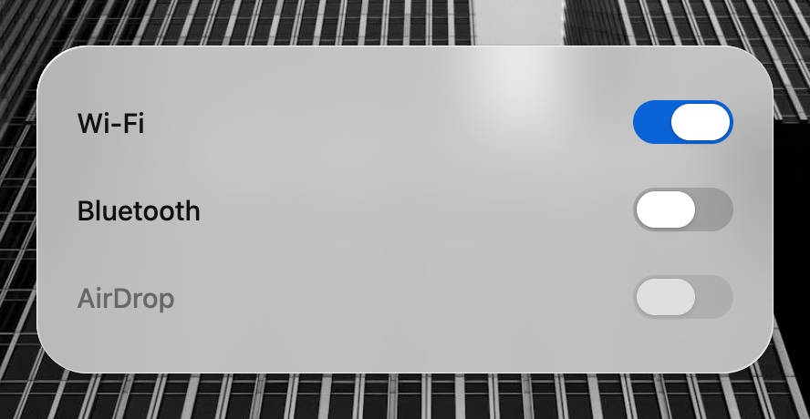
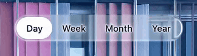

# glass-controls

A small, framework-free layer of glass controls for the web: a nav capsule, buttons, a segmented control with a travelling lens, a slider and a switch whose knobs turn to glass, frosted menus and plain glass surfaces. Each moves on springs the way Apple's controls do: a press swells it, a drag pulls and stretches it, a release springs it back.

The optics are not new. Every surface and lens runs on the WebGL2 engine from [liquid-glass](https://github.com/bilalgursen/liquid-glass) by Bilal Abdullah Gürşen (MIT), bundled here with its notice. This kit adds the controls, the touch physics, the label colour and the accessibility rules. See [Credits](#credits).


## Install and use

```sh
npm install glass-controls
```

```html
<link rel="stylesheet" href="node_modules/glass-controls/dist/glass-controls.css">

<main>
  
  <nav data-glass="surface" style="padding: 4px">
    <ul data-glass="segmented">
      <li><a href="/" aria-current="page">Home</a></li>
      <li><a href="/work">Work</a></li>
    </ul>
  </nav>
  <button data-glass="button">Continue</button>
  <div data-glass="slider"><input type="range" aria-label="Volume"></div>
  <label data-glass="switch"><input type="checkbox"> Wi-Fi</label>
</main>

<script type="module">
  import { init } from 'glass-controls'
  const glass = init()          // wire every [data-glass] in the document
  // glass.destroy()            // undo it all
</script>
```

With a bundler, `import 'glass-controls/glass-controls.css'`. Without one, map the bare name in an import map:

```html
<script type="importmap">{ "imports": {
  "glass-controls": "/node_modules/glass-controls/dist/glass-controls.js"
} }</script>
```

The package has no runtime dependencies.

| Attribute | What it becomes | Guide |
|---|---|---|
| `data-glass="surface"` | A piece of glass | [surface](docs/surface.md) |
| `data-glass="surface" data-glass-menu` | A frosted menu | [nav](docs/nav.md) |
| `data-glass="button"` | A glass button with press, drag and light | [button](docs/button.md) |
| `data-glass="segmented"` | Buttons or links with a draggable lens | [segmented](docs/segmented.md) |
| `data-glass="slider"` | Wraps a range input; the thumb turns to glass | [slider](docs/slider.md) |
| `data-glass="switch"` | Wraps a checkbox; the knob turns to glass | [switch](docs/switch.md) |

Read the [design rules](docs/design-rules.md) before putting glass on a page.

## Two materials

The kit follows Apple's Liquid Glass. Neither material is fully see-through.

- **Controls** (a capsule, a button, a segmented row) are nearly clear: 32% tint over 1 px of blur.
- **Menus** hold rows of text, so they are frosted: 66% tint over 16 px of blur. The browser's own `backdrop-filter` draws this blur, because it reads past the menu's edge and the engine's blur cannot.

```html
<div data-glass="surface" data-glass-menu>…</div>
```

## How it works

1. A WebGL shader cannot read the page, so the kit paints what sits under each surface into a canvas.
2. One shared WebGL2 context bends that picture through a rounded lens, with a light rim and a small colour split at the edge.
3. The result lands on a 2D canvas inside the control, so it scrolls, stacks and clips with it.

Until the first frame, and for good without WebGL2, every control keeps its CSS material. Without WebGL2 or JavaScript no label can change colour, so the tint rises to 72% and dark labels still read.

The page picture has limits. It leaves out shadows, conic gradients, masks, rotation, `::before` and `::after`, and any image from another origin without CORS. Mark such an element with `data-glass-backdrop="css"`, and glass over it uses the CSS material, which reads real pixels. Mark an element with `data-glass-skip` to leave it out of the picture.

## What this kit adds

1. **Touch physics on every control.** One spring model (a response of about 0.3 s, damped to 0.7) drives all of it. A drag pulls a control toward the finger and stretches it along the way it moves, keeping its volume.
2. **A selection that travels.** A segmented lens glides between options, squashes as it goes, and can be grabbed and dragged.
3. **Knobs that turn to glass.** A slider's thumb and a switch's knob are plain pills at rest. Held, they swell into clear lenses.
4. **Labels that read.** Each label measures what shows through the glass behind it and turns white with a dark halo over a dark backdrop.
5. **Native controls underneath.** A real range input and a real checkbox keep the keys, the state and the screen reader.

| Press, then drag | The lens caught between two options |
|---|---|
|  |  |

## What it looks like

| Button at rest | Hovered | Pressed and pulled right | Selected |
|---|---|---|---|
|  |  |  |  |

| Segmented, at rest | Caught between Month and Year |
|---|---|
|  |  |

| Slider at rest | Held: the thumb turns to a lens | Dragged |
|---|---|---|
|  |  |  |

| Nav capsule | Menu open | A finger on a menu row |
|---|---|---|
|  |  |  |

| Surface | Switches in a frosted menu |
|---|---|
|  |  |

Press and drag: [press.mp4](docs/img/press.mp4) ([gif](docs/img/press.gif)), [drag.mp4](docs/img/drag.mp4) ([gif](docs/img/drag.gif)).



## Browser support

| Browser | Glass | Tested here |
|---|---|---|
| Chrome, Edge, Arc, Opera | WebGL2 | Playwright Chromium |
| Firefox | WebGL2 | Playwright Firefox |
| Safari | WebGL2 | Playwright WebKit only |
| No WebGL2 | CSS material | Playwright, WebGL off |
| No JavaScript | CSS material, native controls | Not tested |

The CSS needs `color-mix()`: Chrome 111, Safari 16.2, Firefox 113 or newer. Real Safari, a real iPhone and a range of graphics chips are untested. Playwright WebKit draws no `backdrop-filter`, so it cannot show the frosted menu.

## Performance

- One `requestAnimationFrame` loop drives every spring and stops when all of them are still.
- One WebGL2 context serves every surface and lens.
- A surface re-reads the page at most once per 120 ms. Only surfaces that float (fixed or sticky) re-read it during a scroll.
- A lens reads the page when a finger lands.
- Keep glass to the control layer: a bar, a menu, a few buttons.

## Accessibility

- **Native controls stay native.** The slider is a real `<input type="range">` and the switch a real checkbox with `role="switch"`. Segmented items are real buttons (`aria-pressed`) or links (`aria-current`).
- **Focus rings on glass.** `--gc-focus` is a two-tone ring, white inside and near-black outside, so it reads over any photo.
- **Contrast.** Labels change colour with the backdrop, and a halo hugs their letters. Test your own scenes against WCAG 4.5:1.
- **Reduced motion.** Every spring snaps to its target, so nothing eases or overshoots.
- **Reduced transparency and more contrast.** The engine stays off. The tint rises to 94%, or to a solid fill with an outline.
- **Forced colours.** Glass becomes `Canvas` with a `CanvasText` border, and the selection is a `Highlight` outline.

## When not to use glass

- **Content frames.** Cards, articles, images, tables. Glass is for what floats over content.
- **Long text.** A paragraph on glass sits on a moving, uneven background. Use an opaque surface.
- **Glass on glass.** Make a menu the bar's sibling, not its child.
- **Over nothing.** On a flat page there is nothing to bend. A quiet fill does the job.

## Customise

Every look is a custom property on `:root` or any element:

| Property | Default | |
|---|---|---|
| `--gc-tint` / `--gc-tint-amount` | `#fff` / `32%` | Glass colour and how much of it |
| `--gc-blur` / `--gc-saturate` | `1px` / `1.8` | Frost |
| `--gc-menu-tint-amount` / `--gc-menu-blur` | `66%` / `16px` | A `data-glass-menu` surface |
| `--gc-halo` | white | Hugs a label's letters; `transparent` on a menu |
| `--gc-ink` | `#111` | Text on glass |
| `--gc-radius` | `999px` | Capsule by default |
| `--gc-rim` / `--gc-shadow` | highlights / soft drop | Rim light and shadow |
| `--gc-accent` / `--gc-accent-ink` | blue / white | A selected button, a switch that is on |
| `--gc-pill` / `--gc-pill-ink` | `#fff` / `#111` | A selection, thumb or knob at rest |
| `--gc-track` / `--gc-track-fill` | grey / ink | Slider and switch tracks |
| `--gc-focus` / `--gc-focus-in` | two-tone rings | Focus ring outside a control, and inside a row |

## API

```ts
init(root?: ParentNode): { destroy(): void }  // wire every [data-glass] under root
Spring                                        // the damped spring, if you want it elsewhere
```

`init` does nothing on a server, so it is safe to import during server rendering.

0.2.0 removes `refract` and `LIVE`, along with `data-glass-scene`, `--gc-bezel`, `--gc-refraction` and `--gc-chroma`. The engine replaces them.

## Run the examples

```sh
npm install
npm run serve          # python3 -m http.server 8811
open http://127.0.0.1:8811/examples/
```

`npm run build` rebuilds `dist/` with esbuild. `npm run check` builds, then checks the spring, server safety, the MIT notice, the lack of runtime imports and the material values.

## Credits

- **[liquid-glass](https://github.com/bilalgursen/liquid-glass)** (MIT, Bilal Abdullah Gürşen): the WebGL2 engine and the DOM snapshot. `src/surface.ts` and `src/lens.ts` follow its design.
- **Apple, [WWDC25 "Meet Liquid Glass"](https://developer.apple.com/videos/play/wwdc2025/219/) and the [Human Interface Guidelines on materials](https://developer.apple.com/design/human-interface-guidelines/materials)**: the design rules and the feel of the springs. This project is not affiliated with Apple, and "Liquid Glass" is Apple's name for its material.
- Demo photographs and the full code credits: [docs/CREDITS.md](docs/CREDITS.md).

## Licence

MIT, copyright 2026 Thomas Kramer. The engine is MIT, copyright 2026 Bilal Abdullah Gürşen: see [src/LICENSE.liquid-glass](src/LICENSE.liquid-glass).
