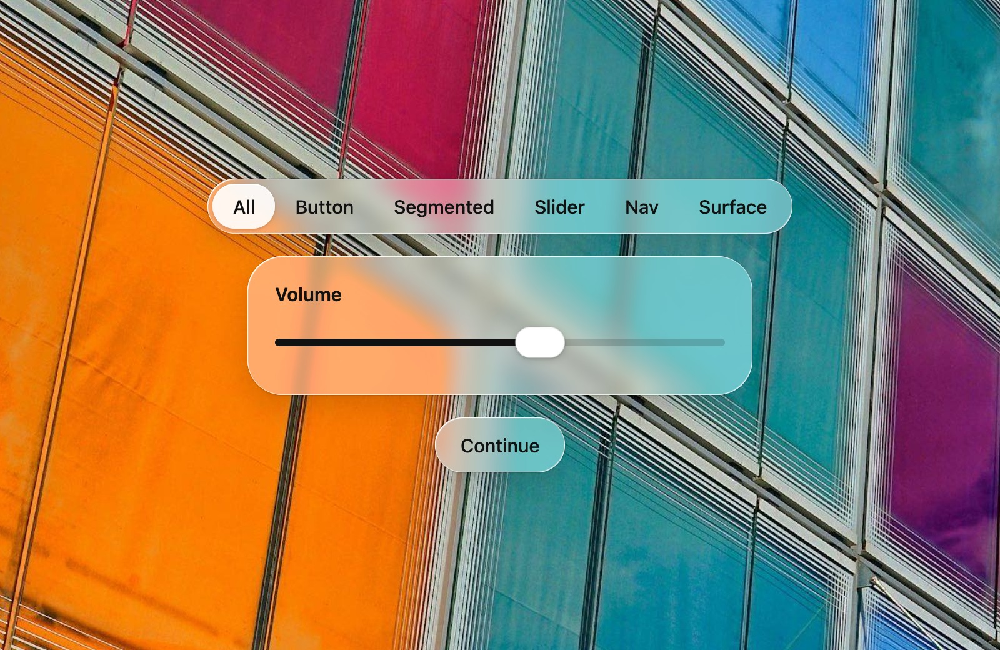
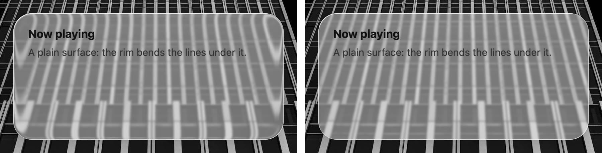
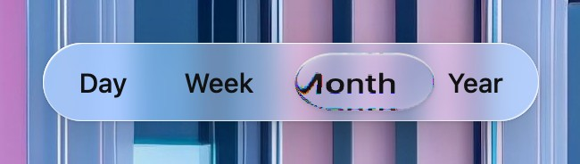
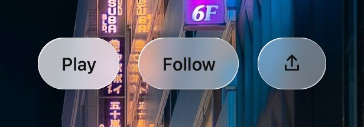
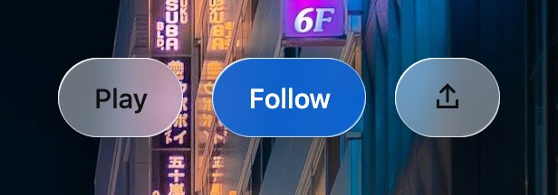
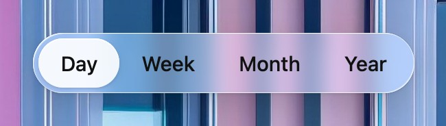
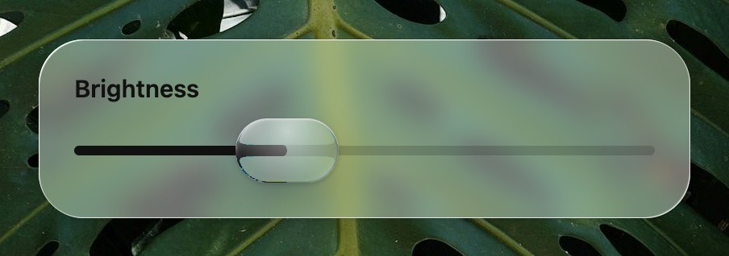
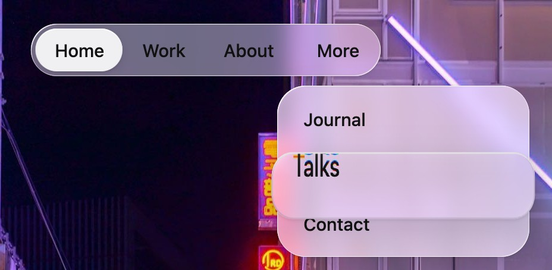
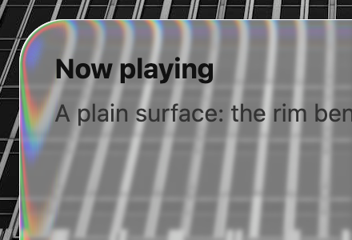

# glass-controls

A small, framework-free control layer of glass for the web: a nav capsule, buttons, a segmented control with a travelling lens, a slider whose thumb magnifies the track, and plain glass surfaces. Each moves on springs the way Apple's controls do: a press swells it, a drag pulls and stretches it, a release springs it back.

It is a kit, not a new optics engine. The live refraction follows the method kube.io published in ["Liquid Glass in the Browser"](https://kube.io/blog/liquid-glass-css-svg/), and every lens is [liquid-glass-js](https://github.com/eamonliu/liquid-glass-js) by Eamon Liu (MIT), a dependency. What this kit adds is the touch physics, the choice of which optic goes where, the controls themselves, and the accessibility rules. See [Prior art](#prior-art-and-credits).



## Install and use (30 seconds)

```sh
npm install glass-controls
```

```html
<link rel="stylesheet" href="node_modules/glass-controls/dist/glass-controls.css">

<main data-glass-scene>
  
  <nav data-glass="surface" style="padding: 4px">
    <ul data-glass="segmented">
      <li><a href="/" aria-current="page">Home</a></li>
      <li><a href="/work">Work</a></li>
    </ul>
  </nav>
  <button data-glass="button">Continue</button>
  <div data-glass="slider"><input type="range" aria-label="Volume"></div>
</main>

<script type="module">
  import { init } from 'glass-controls'
  const glass = init()          // wire every [data-glass] in the document
  // glass.destroy()            // undo it all
</script>
```

With a bundler, `import 'glass-controls/glass-controls.css'`. Without one, map the two bare names in an import map, as the [examples](examples/) do:

```html
<script type="importmap">{ "imports": {
  "glass-controls": "/node_modules/glass-controls/dist/glass-controls.js",
  "liquid-glass-js": "/node_modules/liquid-glass-js/dist/liquid-glass.esm.js"
} }</script>
```

| Attribute | What it becomes | Guide |
|---|---|---|
| `data-glass="surface"` | Glass material; a refracting rim in Chromium | [docs/surface.md](docs/surface.md) |
| `data-glass="button"` | A glass button with press, drag and light physics | [docs/button.md](docs/button.md) |
| `data-glass="segmented"` | A row or column of buttons or links with a travelling, draggable lens | [docs/segmented.md](docs/segmented.md) |
| `data-glass="slider"` | Wraps an `<input type="range">`; the thumb becomes a lens | [docs/slider.md](docs/slider.md) |
| a surface holding a segmented list | A nav capsule, a menu sheet | [docs/nav.md](docs/nav.md) |
| `data-glass-scene` | What lenses show: the nearest such ancestor (else the control itself) | |

Read [docs/design-rules.md](docs/design-rules.md) before putting glass on a page.

## The two optics

Glass on the web can be made two ways, and each fails where the other works.

1. **Live surfaces.** A nav capsule, a menu sheet or a button sits over content that scrolls, plays or changes. Cloning that content would go stale, so surfaces bend the real backdrop: a displacement map built from Snell's law (n = 1.5) over a squircle bezel, run through `feDisplacementMap` inside `backdrop-filter`. Only Chromium runs an SVG filter there. Everywhere else the surface keeps the CSS material (blur, saturation, tint, rim light, shadow), which is what Apple's own web pages show outside Safari's native controls.
2. **Lenses.** A slider thumb or a segmented selection is small and moves. It refracts a clone of what is under it, taken when the finger lands, through liquid-glass-js's height-field lens with chromatic aberration and a specular rim. Cloning works in every browser, so lenses magnify in Firefox and Safari too.

| Refraction on (left) and off (right): the rim bends the lines under it |
|---|
|  |

## What this kit adds

The optics are borrowed, and the credits say from whom. These parts are new here:

1. **Touch physics on every control.** One spring model (a response of about 0.3 s, damped to 0.7) drives all of it. A press swells the control with a small overshoot. A drag pulls it toward the finger like a drop of water and stretches it along the way it moves, keeping its volume. A light follows the finger inside the glass. A release springs it back.
2. **A selection that travels.** In a segmented control the lens glides from one option to the next, squashing as it goes, and it can be grabbed and dragged between options.
3. **A thumb that becomes a lens.** A slider's thumb is plain glass at rest. Held, it turns into a magnifying lens over its own track and stretches with its speed.
4. **Two optics, each where it works.** Surfaces bend the live page, so they never go stale over content that scrolls or plays. Small moving parts use a cloned lens, so they magnify in Firefox and Safari too. Other libraries pick one method for everything.
5. **A lens mounted inside its control.** liquid-glass-js draws a lens over the page. Here it is mounted inside the control and clipped to it, so it scrolls, stacks and clips with the control. That is the `Inset` class in `src/index.js`.
6. **Accessibility as part of the material.** Reduced motion changes state at once with no springs. Reduced transparency and higher contrast swap the glass for a solid surface. Focus rings stay visible on glass, and text keeps its contrast over busy backgrounds. See [docs/design-rules.md](docs/design-rules.md).
7. **Optional colour fringing on surfaces** (`--gc-chroma`), off by default.

| Press, then drag | The lens caught between two options |
|---|---|
|  |  |

## What it looks like

| Button at rest | Hovered | Pressed and pulled right | Selected |
|---|---|---|---|
|  |  |  |  |

| Segmented, at rest | Caught between Month and Year, mid-travel |
|---|---|
|  |  |

| Slider at rest | Held: the thumb turns to a lens | Dragged: it stretches with its speed |
|---|---|---|
|  |  |  |

| Nav capsule | Menu open | A finger dragging down the menu |
|---|---|---|
|  |  |  |

Press and drag physics: [press.mp4](docs/img/press.mp4) ([gif](docs/img/press.gif)), [drag.mp4](docs/img/drag.mp4) ([gif](docs/img/drag.gif)).


### Chromatic aberration

Lenses fringe colour at their rim (liquid-glass-js's three-pass split, on by default). Live surfaces do not, unless you ask: set `--gc-chroma` (0 to 0.5) and the rim splits red, green and blue across three displacement passes. It costs three filter passes instead of one, so it is off by default.



## Browser support

| Browser | Material | Live refracting rim | Lenses | Physics | Tested here |
|---|---|---|---|---|---|
| Chrome, Edge, Arc, Opera (Chromium) | yes | yes | yes | yes | Chromium 156, Playwright |
| Firefox | yes | no: CSS material only | yes | yes | Firefox Nightly (Playwright build), no errors, lens renders |
| Safari | yes (`-webkit-backdrop-filter`) | no: CSS material only | expected (liquid-glass-js supports Safari) | yes | not tested |
| No JavaScript | yes | no | no: native controls show | no | |

Old Playwright headless (`chromium-headless-shell`) does not render `backdrop-filter: url(#…)`; screenshots need the new headless mode (`channel: 'chromium'`) or a headed browser.

## Performance

- One shared `requestAnimationFrame` loop drives every spring and stops when all of them are still.
- A surface's displacement map is drawn once on a canvas (one pass over its pixels) and rebuilt only when its size or the custom properties change. Surfaces over 1.2 megapixels are skipped.
- `backdrop-filter` costs GPU time per frame while the page scrolls. Keep live glass to the control layer: a bar, a menu, a few buttons.
- A lens clones its source (`data-glass-scene`, else the control) when pressed and when its control resizes. Keep the scene to the region that needs it; videos and iframes are stripped from the clone.
- `--gc-chroma` triples the displacement passes on that surface.

## Accessibility

- **Native controls stay native.** The slider is a real `<input type="range">` kept in the page, unseen, for keys and screen readers. Segmented items are real buttons (`aria-pressed`) or links (`aria-current`).
- **Focus rings on glass.** `--gc-focus` is a two-tone ring (white inside, near-black outside) so it reads over any photo. The slider's thumb takes the ring when its range has focus.
- **Contrast over busy backgrounds.** Text on glass needs its tint. The default keeps 52% white (42% where the rim refracts); test your own scenes against WCAG 4.5:1 for body text, and raise `--gc-tint-amount` where a photo is busy behind text. See the [design rules](docs/design-rules.md).
- **Reduced motion.** Under `prefers-reduced-motion: reduce` every spring snaps to its target; nothing overshoots or stretches.
- **Reduced transparency and more contrast.** `prefers-reduced-transparency` raises the tint to 94%; `prefers-contrast: more` makes the glass opaque with a solid outline.
- **Forced colours.** Under `forced-colors: active` glass becomes `Canvas` with a `CanvasText` border, lenses hide, and the selection is a `Highlight` outline.

## When not to use glass

- **Content frames.** Cards, articles, images, tables. Glass is for what floats over content, never for the content.
- **Long text.** A paragraph on glass is a paragraph on a moving, uneven background. Use an opaque surface.
- **Glass on glass.** A `backdrop-filter` parent stops its children's backdrop from seeing the page. Make the menu a sibling of the bar, not its child.
- **Over nothing.** On a flat page there is nothing to bend; a quiet fill does the job.

## Customise

Every look is a custom property on `:root` or any element:

| Property | Default | |
|---|---|---|
| `--gc-tint` / `--gc-tint-amount` | `#fff` / `52%` | Glass colour and how much of it |
| `--gc-blur` / `--gc-saturate` | `14px` / `1.8` | Frost |
| `--gc-ink` | `#111` | Text on glass |
| `--gc-radius` | `999px` | Capsule by default |
| `--gc-rim` / `--gc-shadow` | inset highlights / soft drop | Rim light and shadow |
| `--gc-bezel` / `--gc-refraction` | `14` / `22` | Rim width and the most a ray moves, in px (unitless, read by the script) |
| `--gc-chroma` | `0` | Colour split at live rims, 0 to 0.5 |
| `--gc-accent` / `--gc-accent-ink` | blue / white | A selected button |
| `--gc-pill` | `#fff` | A segmented selection at rest |
| `--gc-focus` | two-tone ring | Focus ring |

The script reads the three unitless ones when a surface is wired and when it resizes.

## API

```ts
init(root?: ParentNode): { destroy(): void }  // wire every [data-glass] under root
refract(el: HTMLElement): () => void          // one live rim; a no-op outside Chromium
LIVE: boolean                                 // true where live rims run
Spring                                        // the damped spring, if you want it elsewhere
```

## Run the examples

```sh
npm install
npm run serve          # python3 -m http.server 8811
open http://127.0.0.1:8811/examples/
```

`npm run build` rebuilds `dist/` with esbuild. `npm run check` runs the self-check for the bend table.

## Prior art and credits

- **[liquid-glass-js](https://github.com/eamonliu/liquid-glass-js)** (MIT, Eamon Liu): every lens. This kit subclasses its `LiquidGlass` to mount the lens inside a control, which reaches into three of its private methods; that is why the dependency is pinned to `0.1.0`.
- **[kube.io, "Liquid Glass in the Browser"](https://kube.io/blog/liquid-glass-css-svg/)**: the live refraction method (Snell's law, squircle bezel, displacement map in `backdrop-filter`). `src/refract.js` is a re-implementation of that write-up, not original work.
- **Apple, [WWDC25 "Meet Liquid Glass"](https://developer.apple.com/videos/play/wwdc2025/219/) and the [Human Interface Guidelines on materials](https://developer.apple.com/design/human-interface-guidelines/materials)**: the design rules and the feel of the springs. This project is not affiliated with Apple, and "Liquid Glass" is Apple's name for its material.
- Related libraries worth knowing: [liquid-glass-react](https://github.com/rdev/liquid-glass-react) (React, Chromium displacement), [shuding/liquid-glass](https://github.com/shuding/liquid-glass) (copy-paste SVG shader), [liquid-glass-web-react](https://github.com/PallavAg/liquid-glass-web-react) (filter on live content, cross-browser), [@avenra/liquid-glass](https://github.com/DevSam7t3/liquid-glass) (backdrop displacement with springs on tooltips and inputs), [rt-liquid-glass](https://github.com/Rethink-JS/rt-liquid-glass) (attribute-driven backdrop displacement).
- Demo photographs from Unsplash: see [docs/CREDITS.md](docs/CREDITS.md).

## Licence

MIT, copyright 2026 Thomas Kramer. liquid-glass-js is MIT, copyright 2026 Eamon Liu, and ships under its own licence as a dependency.
